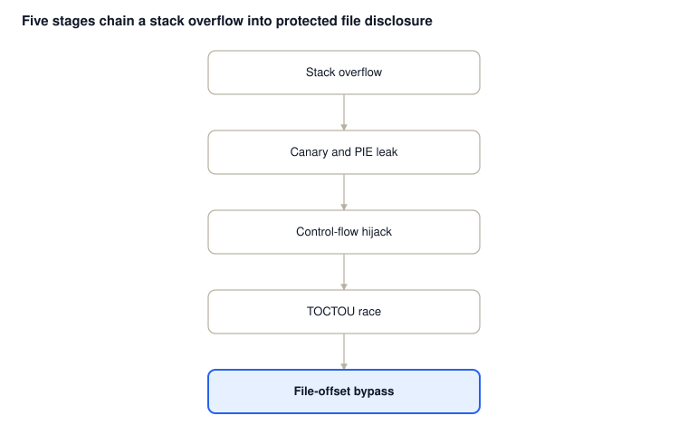
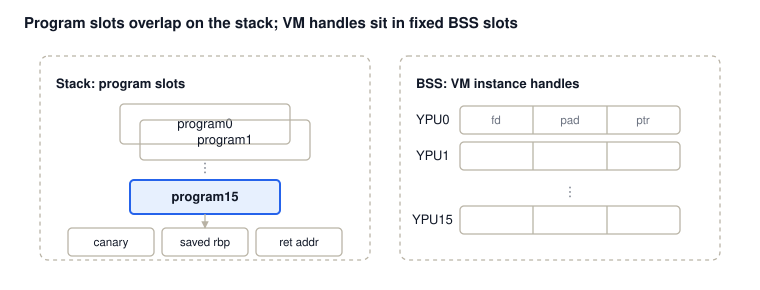
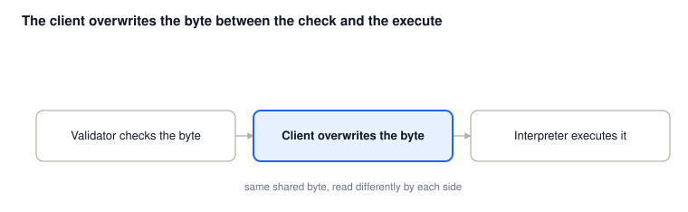
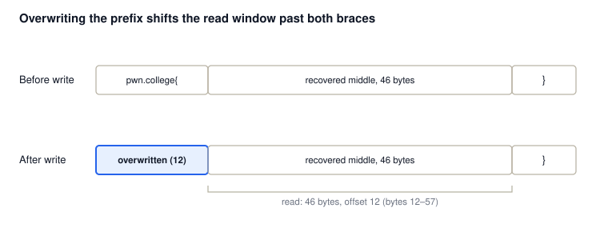

# From Userspace Overflow to Protected File Disclosure: Exploiting a Kernel-Hosted Virtual Machine


## Summary

The exploit chains four stages: a stack overflow in a userspace client, a reconnect-per-guess oracle that leaks the stack canary and a PIE base, a control-flow hijack into native shellcode, and a kernel-side trick that empties a protected file's leading/trailing delimiters so its content slips past a kernel module's own read filter.

The key finding: **neither a kernel address leak nor direct manipulation of `struct file` is required.** The kernel module's own file-write path advances the file offset; by overwriting the flag's prefix and bounding the read length, its content filter never sees the bytes it is checking for.



## Target Architecture

The challenge exposes a TCP service that forks a child per connection; the child is an exact copy of the parent's memory, file descriptors, and registers. Because the server never re-execs or re-randomizes between connections, and the child's own modifications (program slot writes) don't propagate back to the parent, which is why the canary stays stable across guesses.every connection starts from the same canary and the same addresses as the last — which is what makes a byte-by-byte, reconnect-per-guess oracle viable at all.

Each connection's client process maps several device buffers from a privileged kernel module and installs a `seccomp` filter restricting it to a handful of native syscalls (`read`, `write`, `ioctl`, `clone`, `close`); `open` is blocked. The kernel module, however, is itself a small virtual machine: it interprets a custom instruction set supplied by the client, and that instruction set includes its own file operations — open/read/write/exit — which are not gated by the native `seccomp` policy at all. This is the first structural weakness the exploit relies on: the privileged component exposes more capability through its own interpreter than the sandboxing around the client process suggests.

The module also enforces its own content filter on anything it reads back to the client: if a byte of `{` or `}` appears in the result, it fails the read rather than return flag-shaped data.

### Memory Layout

- **Stack:** sixteen program slots (`program0`–`program15`) are addressed `0x300` bytes apart, immediately below the saved frame pointer and return address — but each slot accepts up to `0x1000` bytes of client-supplied code, four times the spacing between slots. A full-size write into any slot therefore overruns into several following slots, and a write into `program15` reaches the canary and saved registers beyond the array. (The specific `0x318`-byte offset the exploit uses to reach the canary was confirmed empirically against the running binary rather than derived from the slot size alone.)
- **BSS:** the VM's sixteen instance handles (`YPU0`–`YPU15`) are small structs — file descriptor, padding, a pointer — laid out at a fixed stride starting at `pie_base + 0x4048`. The pointer field is what later lets native shellcode locate the live, shared VM state.



## Stage 1 — Leaking the Canary and a PIE Base

The overflow in the client's program-loading path reaches the canary and saved return address at a fixed `0x318`-byte offset. Rather than guess the canary outright, the exploit treats the server's own termination behavior as an oracle:

```python
def get_leak(pad_size, leak_id):
    ...
    while len(leak) < 8:
        for b in range(256):
            r = remote('localhost', 1337)
            candidate = current + bytes([b])
            load_program(r, crash_program, candidate)
            r.sendline(b'quit')
            res = r.recvall(timeout=0.2)
            if b"### Goodbye!" in res:
                leak += bytes([b])
                current = candidate
                break
    return u64(leak)
```

A wrong byte trips the stack protector and the connection dies without the goodbye message; a correct byte lets execution reach it. Because each connection forks from the same parent (see Memory Layout), the canary is identical across attempts, so this recovers the canary, the saved base pointer, and the saved return address one byte at a time. The return address also yields a PIE base:

```python
pie_base = saved_rip - 0x1c1e
assert (pie_base & 0xfff) == 0
YPU0_addr = pie_base + 0x4048
```

No kernel leak is needed for any of this — it's entirely userspace PIE arithmetic.

## Stage 2 — Hijacking Control Flow

With the canary and saved registers known, the exploit stages native shellcode at an address computed relative to the leaked base pointer and overwrites the saved frame pointer and return address to point at it, while re-inserting the correct canary so the stack protector still passes. The computed address lands inside `program0`'s own slot — the same buffer the shellcode was uploaded to via `load_program(setup, PROGRAM0, shellcode)` — simply expressed relative to the leaked base pointer instead of as an absolute address:

```python
shellcode_addr = saved_rbp - 0x3090
trampoline_payload  = b'A' * 0x318
trampoline_payload += p64(canary)
trampoline_payload += p64(shellcode_addr) * 2
trampoline_payload += b'B' * (0x1000 - len(trampoline_payload))
load_program(setup, PROGRAM15, trampoline_payload)
```

The shellcode's job is narrow: locate the live VM state via `YPU0_addr`, then win a race against the kernel module's own instruction dispatch (Stage 3).

## Stage 3 — A TOCTOU Race Against the VM's Instruction Filter

Reverse-engineering the module's `ioctl` handler shows a simple fetch-check-execute loop: for every instruction, it calls an internal validator against the current VM state, and only on success does it fetch and interpret the next instruction. A disallowed instruction — in this case, one that reads VM memory — sets an internal signal and aborts the loop immediately rather than running it.

The VM's instruction memory is a buffer shared with, and writable by, the client. That shared, writable state is what turns a conceptually sound check into a race: nothing stops the client from rewriting the targeted instruction byte between the validator's check and the interpreter's fetch of that same byte. The shellcode exploits exactly that window — one native process repeatedly triggers VM execution over `ioctl`, while others continuously flip the targeted byte between an allowed value and the disallowed read instruction. Most attempts lose the race and the validator catches the bad instruction (cheap: one failed `ioctl`, retried immediately); eventually one attempt wins, and the interpreter executes the read instruction the validator never saw.



## Stage 4 — Bypassing the Content Filter via File-Offset Manipulation

With arbitrary VM-level reads now reachable, the exploit's own instruction program does the actual exfiltration — and this is the write-up's central technique.

It opens `/flag` (mode `0400`, but the module's elevated context permits a writable handle regardless) and **writes** over the file's first twelve bytes with filler characters. That write does two things: it removes the leading `flag{` from what a later read would see, and — as an ordinary side effect of `write()` — it advances the file's offset to 5.

A read starting from offset 5 therefore begins immediately after the opening brace. The exploit computes exactly how much more to read so it stops one byte short of the closing brace:

```plain
flag_size = 52; overwritten = 5; closing_brace = 1
read_size = 52 - 5 - 1 = 46   # 0x2e
```



That 46-byte read contains neither brace, so the module's content filter never triggers. The bytes are written out to a second, unrestricted file, and the full flag is reassembled client-side as `flag{` + recovered middle + `}`.

The filter is never defeated or disabled — the read simply never contains the characters it is looking for.

## Why This Beats Manipulating `struct file` Directly

A kernel-address approach — locating the relevant `struct file` and overwriting its `f_pos` field — would need a kernel leak and contend with KASLR. This approach needs neither: `write()` already advances the file's position as a normal side effect, and the subsequent read simply starts from wherever that left it. The only leak the exploit depends on, end to end, is the userspace PIE base.

## Key Takeaways

- A forking server with no re-randomization between connections turns a one-shot memory-disclosure bug into a reliable, repeatable oracle.
- A privileged component's own internal checks are only as strong as the memory they check: if the checked state is shared and writable, a TOCTOU race can beat even a correctly-written validator.
- A content filter on file reads can be routed around by manipulating file *state* (position, content) rather than the filter itself.
